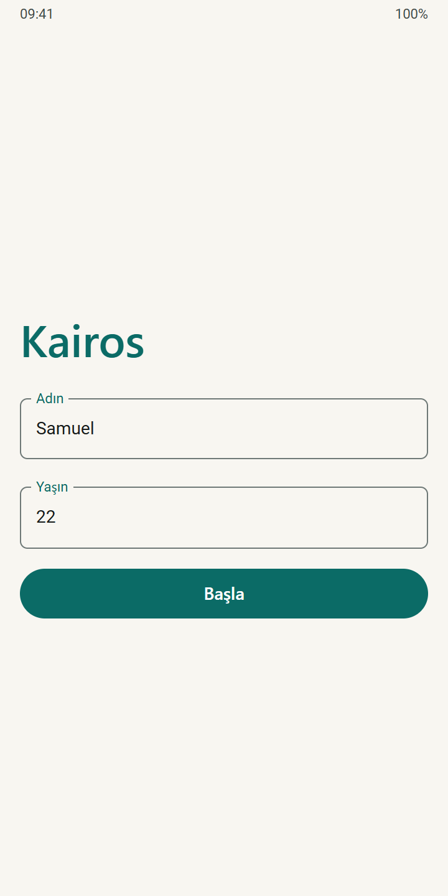
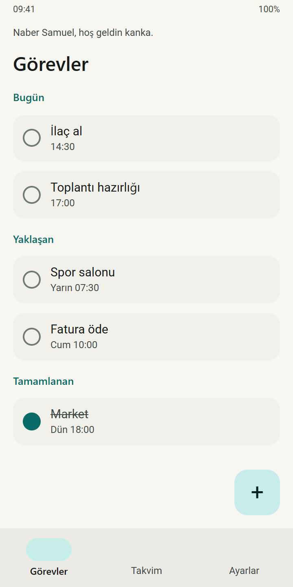
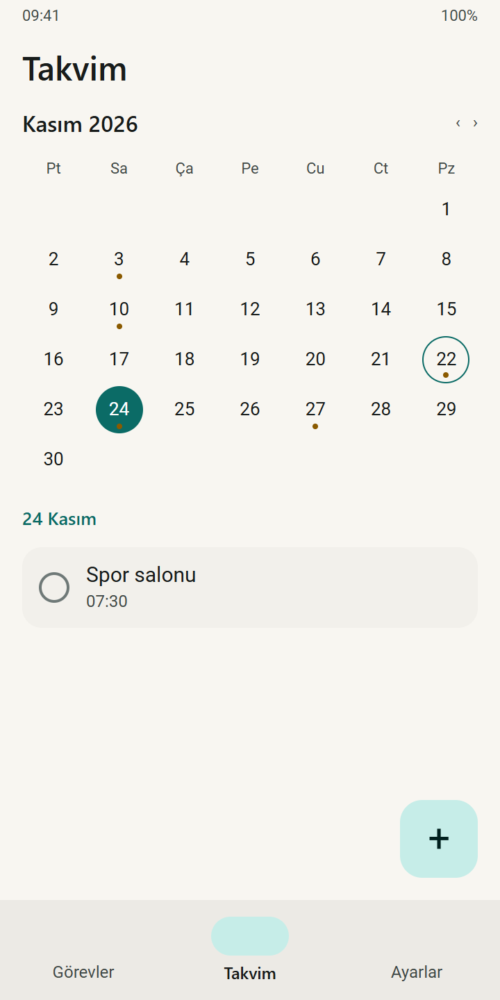
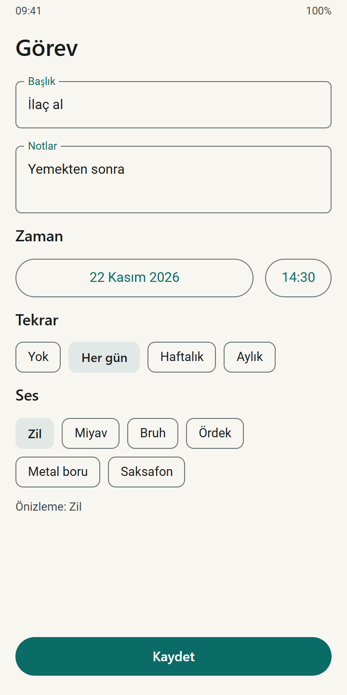
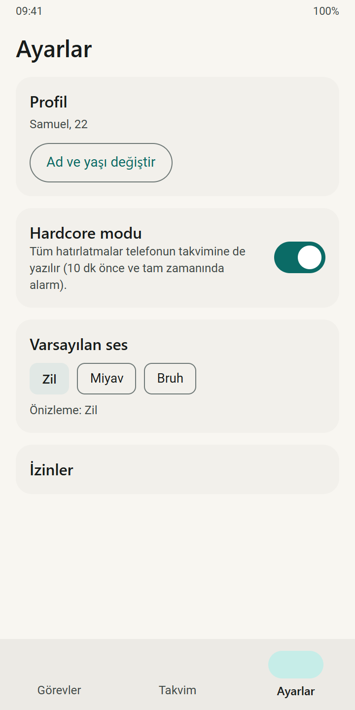
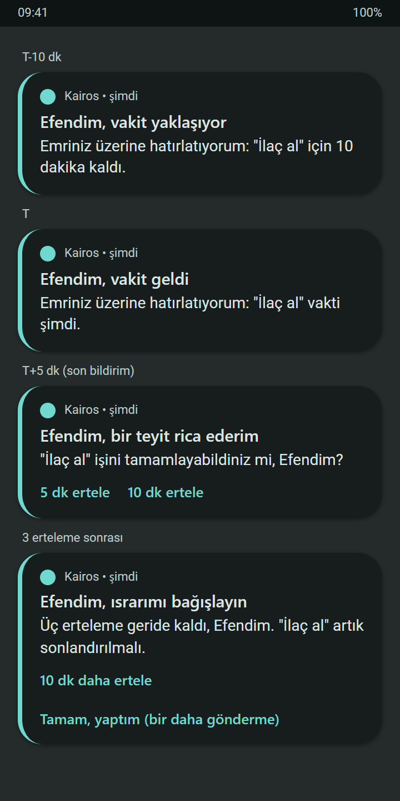
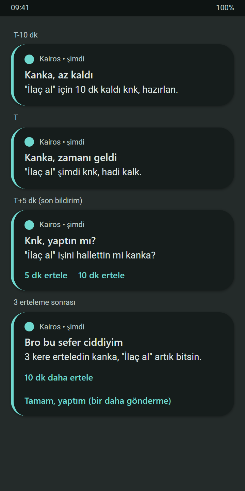

# Kairos

*Yaşına göre konuşan, ertelemene izin vermeyen, tamamen çevrimdışı hatırlatıcı.*
(An offline reminder app that talks to you according to your age and won't let you ignore it.)

Kairos is an Android reminder app written in Kotlin with Jetpack Compose (Material 3). The UI is in Turkish. It does not just chime once: every reminder becomes a small escalating chain of sticky notifications, in a tone chosen from your age.

## Status

- Built: the debug APK builds (`:app:assembleDebug`).
- Unit-tested: recurrence, snooze state machine and tone selection (`LogicTest`).
- **Not yet tested on a real device or emulator.** Notification behaviour, exact alarms, full-screen intents, sounds and calendar sync are implemented but still pending on-device verification.

## Features

- **Age-based tone.** At onboarding you enter a name and age. 30 and over gets a formal, Jarvis-like butler voice ("Efendim, vakit geldi"); under 30 gets Gen Z slang ("Kanka, zamanı geldi"). All greetings, notifications, empty states and snackbars follow the tone (`logic/Tone.kt`).
- **Reminder chain.** Each reminder fires three notifications around its time `T`: a heads-up at **T-10 min**, the main alert at **T**, and a "did you do it?" check at **T+5 min**.
- **Non-dismissable, aggressive notifications.** They are ongoing, not auto-cancelled, have no dismiss action, use a max-importance alarm channel with vibration, bypass Do Not Disturb and show on the lock screen. If one is swiped away, a delete intent re-posts it. The T and T+5 notifications also request a full-screen intent.
- **Snooze-only final notification.** The T+5 notification offers only **5 min snooze** and **10 min snooze**.
- **After three snoozes.** Only **"10 dk daha ertele"** (10 more minutes) or **"Tamam, yaptım"** (done, never notify again) remain, and the copy gets sterner ("Bro bu sefer ciddiyim" / "Efendim, ısrarımı bağışlayın").
- **Per-reminder sounds.** 16 bundled sounds (Ack, Amogus, Apple Pay, Zil, Bruh, Dexter, Ördek, Enrique, Hehe, Miyav, Metal boru, Prowler, Rizz, Saksafon, Spiderman, Sünger Bob). Pick one per reminder, set a default in Settings, preview before saving. Each sound gets its own notification channel.
- **Repeats.** None, daily, weekly (chosen weekdays) or monthly (clamped to short months).
- **Hardcore mode.** Optional. Mirrors every reminder into a local "Kairos" calendar on the phone (alarm 10 min before and at the time), so it also fires through the system calendar. Needs calendar permission; turning it off removes the entries.
- **Tasks and calendar views.** Today / upcoming / done lists and a month calendar with day markers.
- **Fully offline.** No `INTERNET` permission, no accounts, no analytics. Data stays in a local database.

Permissions used: notifications, exact alarms, full-screen intent, boot completed (to reschedule), vibrate, and read/write calendar (Hardcore mode only).

## Screenshots

> **These are UI mockups rendered from the app's design and strings, not real device captures.** They are HTML renderings that use the palette from `ui/Theme.kt` and the copy from `logic/Tone.kt` and the Compose screens. Real Android rendering will differ in details. Source: [`docs/mockups/mockups.html`](docs/mockups/mockups.html).

| Onboarding | Tasks | Calendar | Edit reminder | Settings |
|---|---|---|---|---|
|  |  |  |  |  |

Notification chain (T-10, T, T+5, after three snoozes), formal tone and Gen Z tone, dark theme:

| Formal | Gen Z |
|---|---|
|  |  |

Dark variants of every screen, and the formal-tone onboarding/task list, are in [`docs/screenshots/`](docs/screenshots/).

## Build

Requirements: JDK 17, Android SDK (compileSdk 35, minSdk 26), Gradle 8.9. The repo has no Gradle wrapper, so use a local Gradle 8.9.

```sh
# point Gradle at the SDK (local.properties is git-ignored)
echo "sdk.dir=/path/to/Android/Sdk" > local.properties

gradle :app:testDebugUnitTest     # unit tests
gradle :app:assembleDebug         # app/build/outputs/apk/debug/*.apk
```

## CI

GitHub Actions (`.github/workflows/android.yml`) runs on every push, pull request and manual dispatch: Temurin JDK 17, Android SDK, Gradle 8.9, then unit tests and the debug APK build. The APK is uploaded as the `kairos-debug-apk` artifact.

## License

MIT, see [LICENSE](LICENSE).
