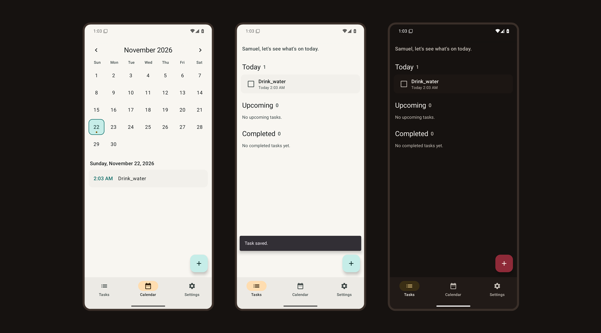
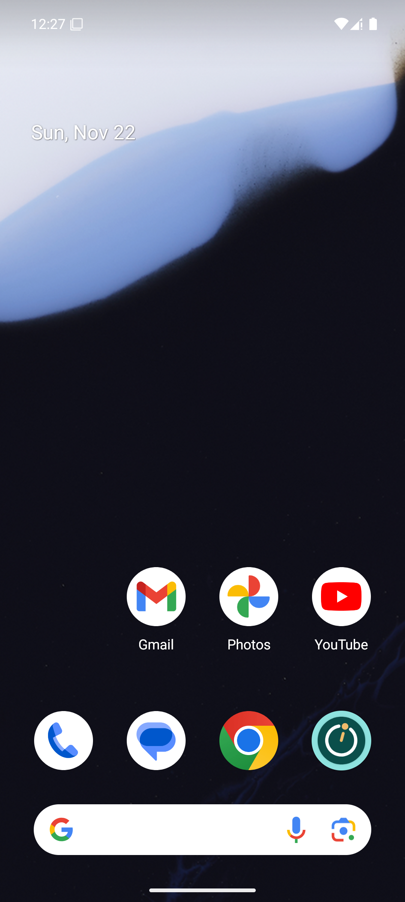
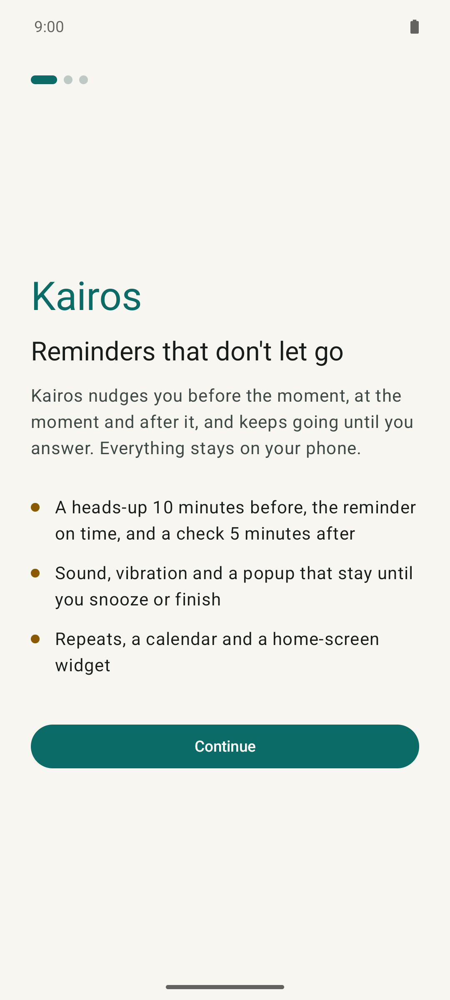
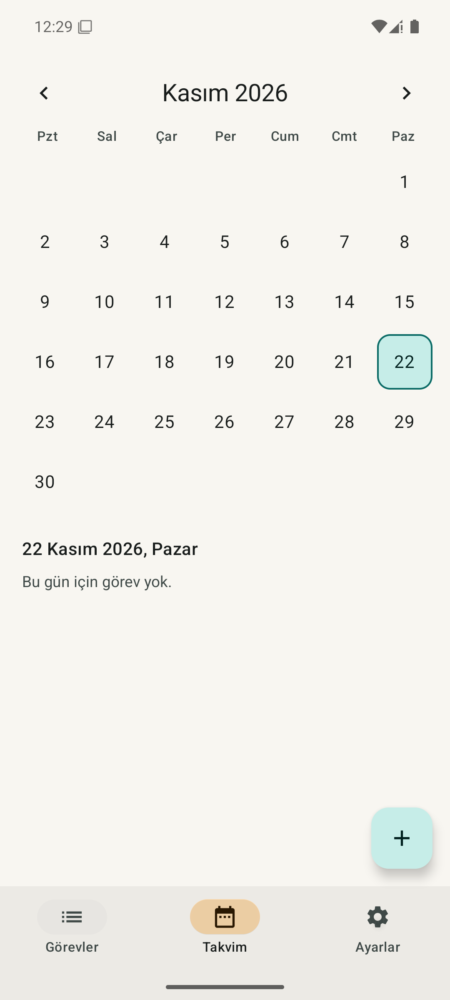
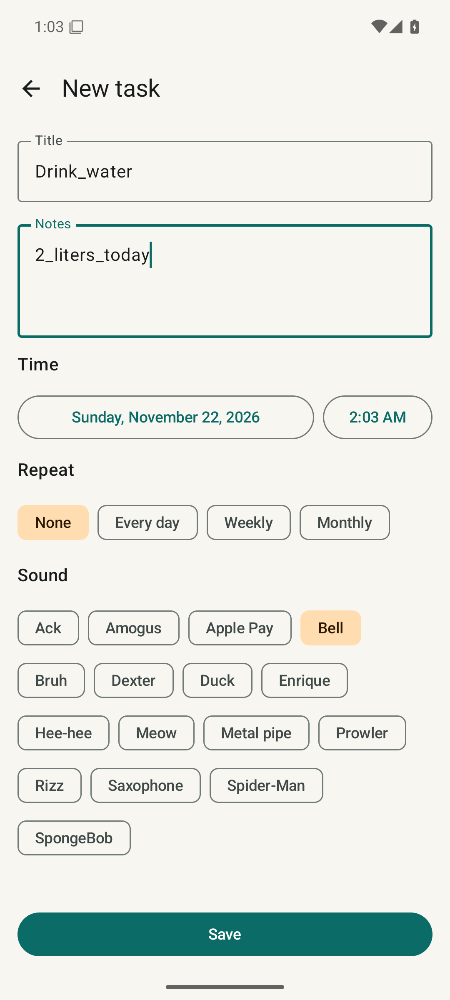
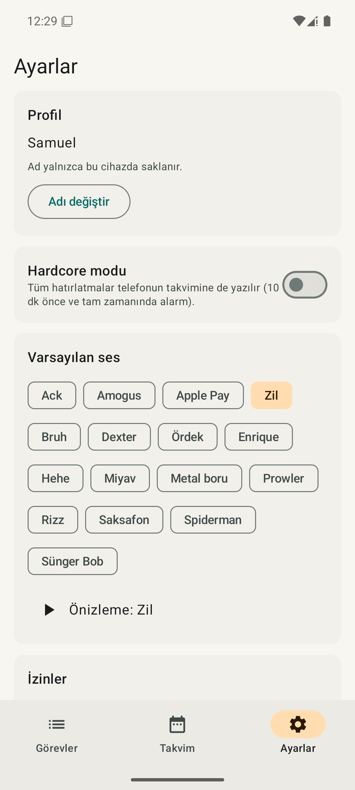
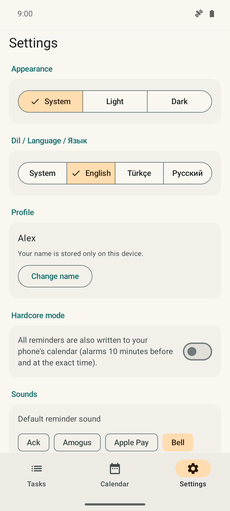
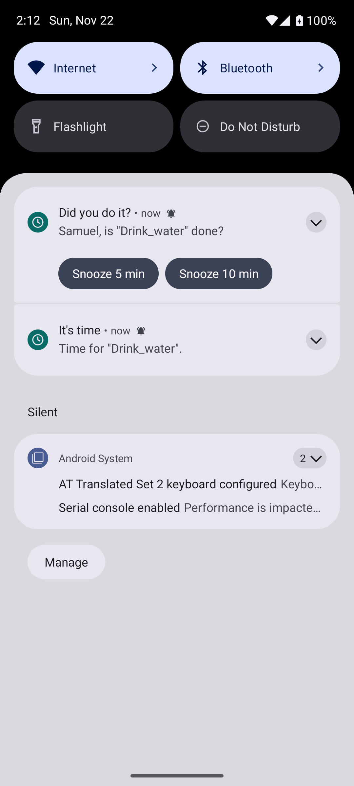

<p align="center">
  
</p>

<h1 align="center">Kairos</h1>

<p align="center">
  Напоминалка, которую нельзя проигнорировать.<br>Задачи, повторы, календарь и «липкие» уведомления — офлайн на вашем Android.
</p>

<p align="center">
  <a href="https://github.com/Kw4nzah/Kairos/releases/latest"></a>
  
  
  
</p>

<p align="center">
  <a href="https://github.com/Kw4nzah/Kairos/releases/latest"><b>Скачать APK</b></a>
  ·
  <a href="README.md">English</a>
  ·
  <a href="README.tr.md">Türkçe</a>
  ·
  <a href="README.ru.md">Русский</a>
</p>

---

Kairos — приложение-напоминалка для Android на Kotlin и Jetpack Compose (Material 3). Оно не звенит один раз и замолкает: каждое напоминание превращается в небольшую цепочку нарастающих «липких» уведомлений в одном понятном и дружелюбном тоне. Доступно на английском, русском и турецком.

**Установка:** скачайте `Kairos-1.4.3.apk` из [последнего релиза](https://github.com/Kw4nzah/Kairos/releases/latest), откройте на телефоне и при запросе разрешите установку из браузера или файлового менеджера. APK подписан отладочным ключом, поэтому Play Protect может попросить подтверждение.


## Статус

- Сборка: релизы — это уменьшенные APK, собранные локально (`:app:assembleRelease`).
- Модульные тесты: повторения, расписание будильников с отсрочкой, конечный автомат отсрочки и выбор вариантов текста (`LogicTest`, `ChainTest`, `UpdaterTest`).
- Проверено на эмуляторе (Android 15): цепочка уведомлений, отсрочка после перезагрузки, будильник на телефоне с PIN-блокировкой, обновление с 1.4.0, три языка и обе темы.
- **Проверка на реальном устройстве ограничена.** Окно будильника работало на телефоне. Включение экрана, точные будильники при управлении батареей от производителя, звук и синхронизацию с календарём ещё нужно проверить на устройстве.

## Возможности

- **Один дружелюбный тон.** Приветствие в списке задач, тексты уведомлений, пустые состояния и сообщения snackbar звучат одинаково понятно и приветливо (`logic/Tone.kt`, тексты берутся из строковых ресурсов).
- **Цепочка напоминаний.** Каждое напоминание отправляет три уведомления вокруг времени `T`: предупреждение за **10 минут до T**, основное уведомление в **T** и проверка «Получилось?» через **5 минут после T**.
- **Уведомления, которые нельзя закрыть.** Они постоянные, не закрываются автоматически, без кнопки закрытия, используют канал будильника с максимальной важностью и вибрацией, обходят режим «Не беспокоить» и видны на экране блокировки. Если уведомление смахнули, delete intent публикует его снова. Уведомления в T и T+5 также запрашивают показ на весь экран.
- **Финальное уведомление только с отсрочкой.** Уведомление T+5 предлагает лишь **Отложить на 5 мин** и **Отложить на 10 мин**.
- **Отсрочка заменяет цепочку.** Звонит только отложенный будильник; он сохраняется после перезагрузки, обновления приложения и смены времени.
- **После трёх отсрочек.** Остаются только **«Отложить ещё на 10 мин»** и **«Готово, больше не напоминать»**, а текст становится чуть строже.
- **Звук для каждого напоминания.** 16 встроенных звуков. Выберите звук для напоминания, задайте звук по умолчанию в настройках, прослушайте перед сохранением. У каждого звука свой канал уведомлений.
- **Повторы.** Нет, ежедневно, еженедельно (выбранные дни) или ежемесячно (с поправкой на короткие месяцы).
- **Виджет на главном экране.** Ближайшие напоминания с первого взгляда: нажмите на кружок, чтобы отметить выполненным, или на «+», чтобы добавить новое. Меняет размер, подстраивается под светлую/тёмную тему.
- **Обновления в приложении.** Настройки → О приложении проверяет последний релиз на GitHub и может скачать и установить его (проверка SHA-256, пакета и подписи; Android всё равно запросит подтверждение).
- **Окно будильника.** С момента напоминания экран включается, а поверх экрана блокировки и других приложений открывается окно; кнопка «Назад» его не закрывает, только отсрочка или «Готово». Звук и вибрация повторяются, пока не нажата отсрочка или «Готово». Нужно разрешение «Поверх других приложений»; на Android 14+ разрешите также «Включение экрана» (Настройки → Разрешения). Там же есть кнопка «Проверить будильник», а на телефонах Xiaomi — ярлык к скрытым системой разрешениям на всплывающие окна и экран блокировки.
- **Режим Hardcore.** По желанию. Дублирует каждое напоминание в локальный календарь «Kairos» на телефоне (сигнал за 10 минут и точно в срок), так что оно срабатывает и через системный календарь. Нужно разрешение на календарь; при выключении записи удаляются.
- **Списки задач и календарь.** Списки «Сегодня / Предстоящие / Выполненные» и календарь на месяц с отметками дней. Даты, названия месяцев и дней недели и первый день недели соответствуют выбранному языку.
- **Выбор темы.** В настройках можно следовать системе или принудительно включить светлую либо тёмную тему.
- **Языки.** Английский, русский и турецкий. По умолчанию Kairos следует языку системы; в настройках есть раздел языка (Системный / English / Türkçe / Русский), который применяется мгновенно благодаря поддержке языка для отдельных приложений в Android. Уведомления и записи в календаре тоже используют выбранный язык.
- **Приватность.** Нет аккаунтов, нет аналитики. Данные остаются в локальной базе. Единственное обращение к сети — проверка обновлений: она связывается с GitHub и ничего о вас не отправляет.

Используемые разрешения: уведомления, точные будильники, показ на весь экран, поверх других приложений (окно будильника), включение экрана (Android 14+), завершение загрузки (для перепланирования), вибрация, интернет и установка пакетов (только обновления), исключение из экономии батареи (по желанию), чтение/запись календаря (только режим Hardcore).

## Скриншоты

Сняты на эмуляторе Android.

| Значок | Приветствие | Задачи | Редактирование | Календарь | Настройки | Уведомление |
|---|---|---|---|---|---|---|
|  |  |  |  |  |  |  |

## Сборка

Требования: JDK 17, Android SDK (compileSdk 35, minSdk 26), Gradle 8.9. В репозитории нет Gradle wrapper, поэтому используйте локальный Gradle 8.9.

```sh
# укажите Gradle путь к SDK (local.properties игнорируется git)
echo "sdk.dir=/path/to/Android/Sdk" > local.properties

gradle :app:testDebugUnitTest     # модульные тесты
gradle :app:assembleRelease       # app/build/outputs/apk/release/*.apk (подписан локальным отладочным ключом)
gradle :app:lintDebug             # lint (отсутствующие переводы, жёстко заданный текст, ...)
```

## Локализация

Весь видимый пользователю текст хранится в строковых ресурсах Android: `app/src/main/res/values/strings.xml` (английский, по умолчанию), `values-tr/` (турецкий) и `values-ru/` (русский). В текстах тона используются подстановки `%1$s` (имя) и `%2$s` (название задачи) и массивы строк для случайных вариантов. Чтобы добавить язык, создайте `values-xx/strings.xml`, укажите его в `res/xml/locales_config.xml` и добавьте в `AppLanguage`.

## Лицензия

MIT, см. [LICENSE](LICENSE).
