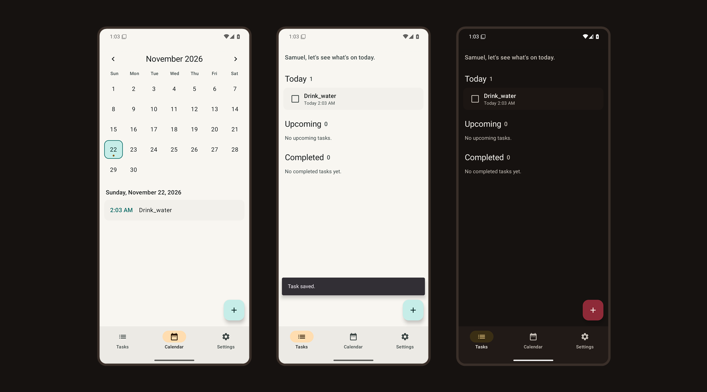
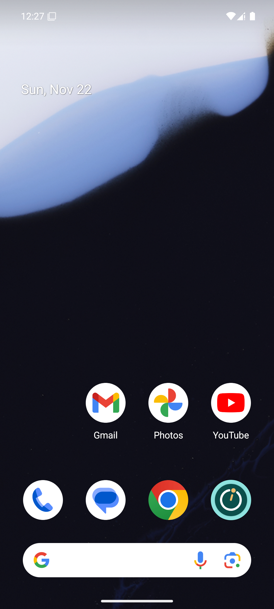
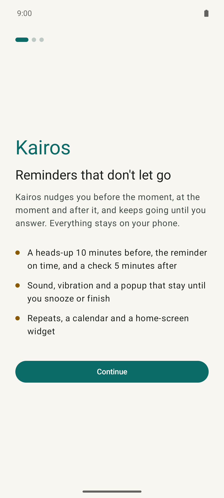
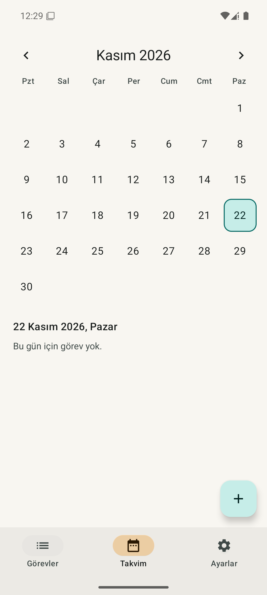
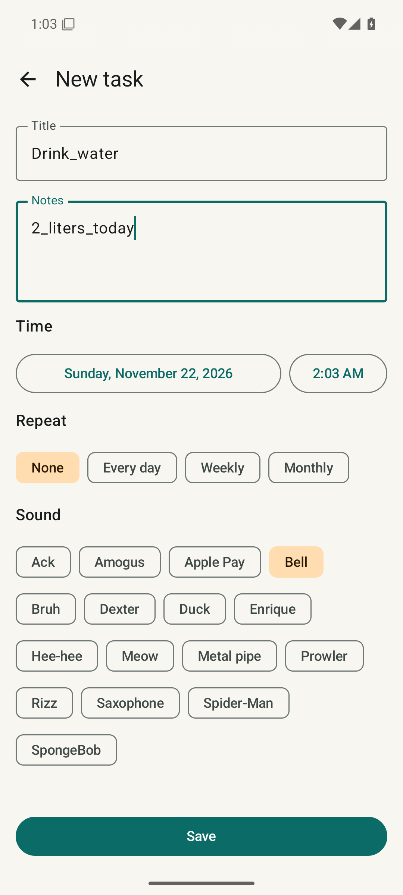
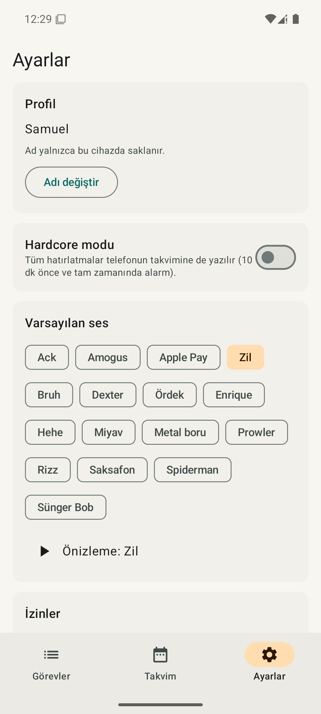
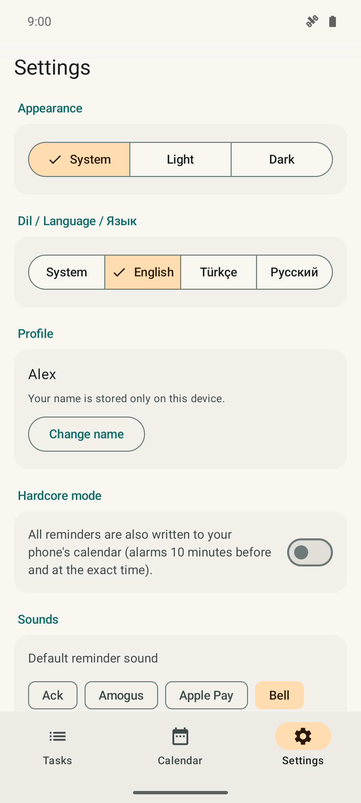
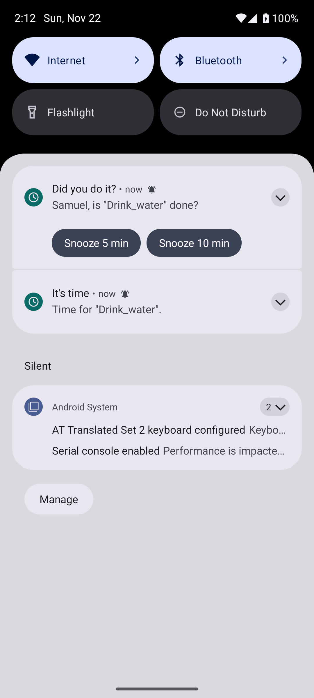

<p align="center">
  
</p>

<h1 align="center">Kairos</h1>

<p align="center">
  Görmezden gelmene izin vermeyen bir hatırlatıcı.<br>Görevler, tekrarlar, takvim ve yapışkan bildirimler; Android telefonunda, çevrimdışı.
</p>

<p align="center">
  <a href="https://github.com/Kw4nzah/Kairos/releases/latest"></a>
  <a href="https://github.com/Kw4nzah/Kairos/actions/workflows/android.yml"></a>
  
  
  
</p>

<p align="center">
  <a href="https://github.com/Kw4nzah/Kairos/releases/latest"><b>APK'yı indir</b></a>
  ·
  <a href="README.md">English</a>
  ·
  <a href="README.tr.md">Türkçe</a>
  ·
  <a href="README.ru.md">Русский</a>
</p>

---

Kairos, Kotlin ve Jetpack Compose (Material 3) ile yazılmış bir Android hatırlatıcı uygulamasıdır. Bir kez çalıp susmaz: her hatırlatma, tek bir net ve samimi tonda, giderek yükselen yapışkan bildirimlerden oluşan küçük bir zincire dönüşür. İngilizce, Rusça ve Türkçe kullanılabilir.

**Kurulum:** [son sürümden](https://github.com/Kw4nzah/Kairos/releases/latest) `Kairos-1.3.0.apk` dosyasını indir, telefonda aç ve istenirse tarayıcın veya dosya yöneticin için bilinmeyen kaynaklardan kurulumuna izin ver. APK debug anahtarıyla imzalıdır, Play Protect onay isteyebilir.


## Durum

- Derleniyor: debug APK derlenir (`:app:assembleDebug`).
- Birim testleri var: tekrar mantığı, erteleme durum makinesi ve ton varyantı seçimi (`LogicTest`).
- Emülatörde test edildi: bildirim zinciri (ön uyarı, ana bildirim, kontrol, erteleme düğmeleri) bir Android emülatöründe baştan sona çalıştırıldı.
- **Henüz gerçek cihazda test edilmedi.** Gerçek pil yönetimi altında tam zamanlı alarmlar, tam ekran bildirimler, sesler ve takvim eşitlemesinin cihaz üzerinde doğrulanması gerekiyor.

## Özellikler

- **Tek samimi ton.** Görev listesindeki karşılama, bildirim metinleri, boş durumlar ve snackbar mesajları aynı net ve samimi sesi kullanır (`logic/Tone.kt`, metinler string kaynaklarından gelir).
- **Hatırlatma zinciri.** Her hatırlatma, `T` zamanı çevresinde üç bildirim gönderir: **T-10 dk** ön uyarı, **T** anında ana bildirim ve **T+5 dk** "Yaptın mı?" kontrolü.
- **Kapatılamayan, ısrarcı bildirimler.** Kalıcıdır, otomatik kapanmaz, kapatma düğmesi yoktur, titreşimli en yüksek önemde alarm kanalı kullanır, Rahatsız Etme'yi aşar ve kilit ekranında görünür. Biri kaydırılarak silinirse silme niyeti (delete intent) onu yeniden gönderir. T ve T+5 bildirimleri ayrıca tam ekran niyeti ister.
- **Yalnızca ertelemeli son bildirim.** T+5 bildirimi yalnızca **5 dk ertele** ve **10 dk ertele** seçeneklerini sunar.
- **Üç erteleme sonrası.** Yalnızca **"10 dk daha ertele"** veya **"Tamam, yaptım (bir daha gönderme)"** kalır; metin biraz daha kararlı olur.
- **Hatırlatma başına ses.** 16 hazır ses. Her hatırlatma için birini seç, Ayarlar'da varsayılan belirle, kaydetmeden önce dinle. Her ses kendi bildirim kanalını alır.
- **Tekrarlar.** Yok, günlük, haftalık (seçilen günler) veya aylık (kısa aylara göre ayarlanır).
- **Hardcore modu.** İsteğe bağlı. Her hatırlatmayı telefondaki yerel bir "Kairos" takvimine yansıtır (10 dk önce ve tam zamanında alarm), böylece sistem takvimi üzerinden de çalar. Takvim izni gerekir; kapatınca kayıtlar silinir.
- **Alarm penceresi.** Ana hatırlatmadan itibaren kilit ekranının ve diğer uygulamaların üstünde tam ekran bir pencere açılır; Geri tuşu kapatmaz, yalnızca ertele ya da tamam kapatır. "Diğer uygulamaların üzerinde göster" izni gerekir (Ayarlar → İzinler).
- **Ana ekran widget'ı.** Sıradaki hatırlatmalar tek bakışta; daireye dokunup yapıldı işaretle, "+" ile yenisini ekle. Boyutlandırılabilir, açık/koyu temaya uyar.
- **Uygulama içi güncelleme.** Ayarlar → Hakkında en son GitHub sürümünü kontrol eder, senin için indirip kurabilir (SHA-256 doğrulamalı; Android yine onay ister).
- **Görev ve takvim görünümleri.** Bugün / yaklaşan / tamamlanan listeleri ve gün işaretli aylık takvim. Tarihler, ay ve gün adları ile haftanın ilk günü seçili dile uyar.
- **Tema seçimi.** Ayarlar'dan sistemi izle, açık veya koyu temayı zorla.
- **Diller.** İngilizce, Rusça ve Türkçe. Varsayılan olarak Kairos sistem dilini izler; Ayarlar'daki dil bölümü (Sistem / English / Türkçe / Русский) Android'in uygulama başına dil desteğiyle anında uygulanır. Bildirimler ve takvim kayıtları da seçilen dili kullanır.
- **Gizlilik odaklı.** Hesap yok, analitik yok. Veriler yerel bir veritabanında kalır. Tek ağ kullanımı güncelleme kontrolüdür; GitHub ile konuşur ve senin hakkında hiçbir şey göndermez.

Kullanılan izinler: bildirimler, tam zamanlı alarm, tam ekran niyeti, diğer uygulamaların üzerinde gösterme (alarm penceresi), açılış tamamlandı (yeniden zamanlamak için), titreşim, internet ve paket kurma (yalnızca güncelleme), pil kısıtlaması muafiyeti (isteğe bağlı) ve takvim okuma/yazma (yalnızca Hardcore modu).

## Ekran görüntüleri

Bir Android emülatöründe alınmıştır.

| Başlatıcı simgesi | Karşılama | Görevler | Hatırlatma düzenle | Takvim | Ayarlar | Bildirim |
|---|---|---|---|---|---|---|
|  |  |  |  |  |  |  |

## Derleme

Gereksinimler: JDK 17, Android SDK (compileSdk 35, minSdk 26), Gradle 8.9. Depoda Gradle wrapper yoktur, yerel bir Gradle 8.9 kullan.

```sh
# Gradle'ı SDK'ya yönlendir (local.properties git tarafından yok sayılır)
echo "sdk.dir=/path/to/Android/Sdk" > local.properties

gradle :app:testDebugUnitTest     # birim testleri
gradle :app:assembleDebug         # app/build/outputs/apk/debug/*.apk
gradle :app:lintDebug             # lint (eksik çeviriler, sabit metinler, ...)
```

## Yerelleştirme

Kullanıcıya görünen tüm metinler Android string kaynaklarındadır: `app/src/main/res/values/strings.xml` (İngilizce, varsayılan), `values-tr/` (Türkçe) ve `values-ru/` (Rusça). Ton metinleri `%1$s` (ad) ve `%2$s` (görev başlığı) yer tutucularını ve rastgele varyantlar için string dizilerini kullanır. Yeni dil eklemek için `values-xx/strings.xml` ekle, `res/xml/locales_config.xml` içine yaz ve `AppLanguage`'e ekle.

## CI

GitHub Actions (`.github/workflows/android.yml`) her push, pull request ve elle tetiklemede çalışır: Temurin JDK 17, Android SDK, Gradle 8.9, ardından birim testleri ve debug APK derlemesi. APK, `kairos-debug-apk` artifact'i olarak yüklenir.

## Lisans

MIT, bkz. [LICENSE](LICENSE).
